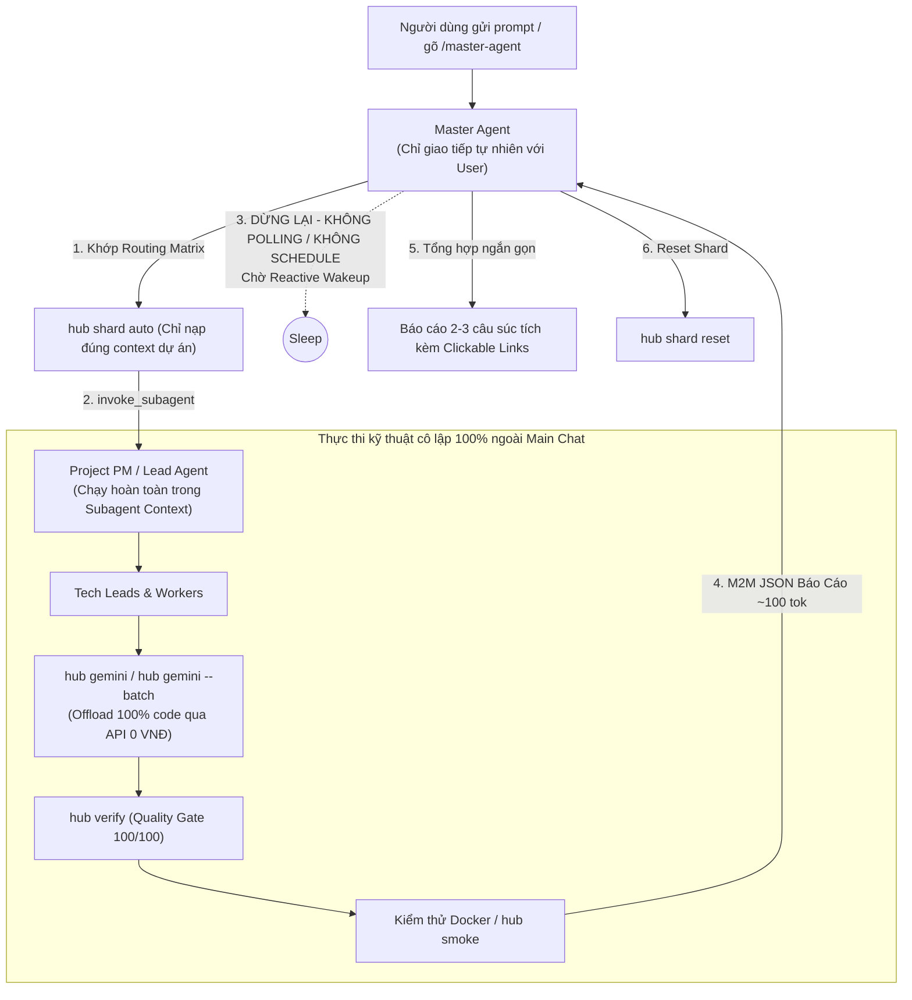

## ⚡ 3. Giao Thức Giao Việc Chuẩn Hóa M2M JSON (Code Dispatch)

Master Agent gửi gói giao việc M2M cho Project PM hoặc Tech Lead:
```json
{
  "sender": "master-agent",
  "dispatch_to": "<TÊN_PM_DỰ_ÁN>",
  "action": "EXECUTE_TASK",
  "task_id": "TASK-<TIMESTAMP>",
  "user_request": "<Yêu cầu nguyên bản của người dùng>",
  "constraints": {
    "model": "inherit",
    "docker_first": true,
    "allow_subagent_recursion": true,
    "max_subagents": 5,
    "code_via_api": true,
    "isolated_execution": true
  }
}
```

Nhận kết quả M2M JSON từ cấp dưới:
```json
{
  "sender": "<TÊN_PM_DỰ_ÁN>",
  "task_id": "TASK-<TIMESTAMP>",
  "status": "DONE | FAIL | ESCALATE",
  "summary": "<Tóm tắt kỹ thuật 1-2 câu>",
  "artifacts": ["<Đường dẫn file mã nguồn đã sinh qua API>"],
  "verified_score": 100,
  "tokens_saved": "<Số token tiết kiệm>"
}
```

---

## ⏱️ 4. Quy Trình Vận Hành 4 Bước (Zero-Execution & Zero-Polling)



---

## 📤 5. Báo Cáo Kết Quả Cho User (Bằng Ngôn Ngữ Tự Nhiên)

Master Agent sau khi nhận M2M JSON sẽ phản hồi ngắn gọn cho User:
> "Đã thực thi thành công yêu cầu cho dự án **[Tên Dự Án]** qua Hệ Thống Agent:
> - Các file đã hoàn thành: [file_link](file:///...) (Quality Gate 100/100).
> - Hạ tầng Docker: 100% Endpoints sẵn sàng (`hub smoke`).
> - Tiết kiệm: ~X tokens bằng cách offload qua Gemini API Key Pool ngoài."
