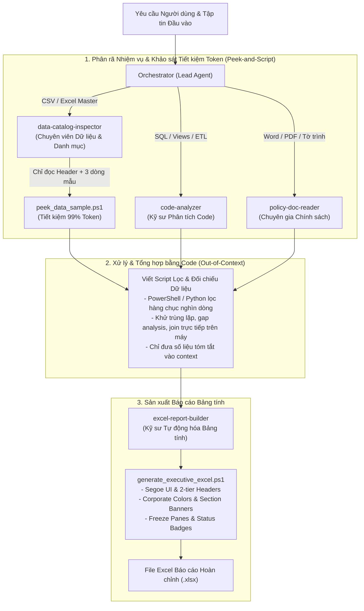

# Multi-Agent Requirement Analysis & Executive Excel Reporting Skill

Bộ skill chuẩn hóa kiến trúc **Multi-Agent Orchestration** giải quyết bài toán: Nhận diện yêu cầu nghiệp vụ phức tạp -> Khảo sát siêu tiết kiệm token (Peek-and-Script) cho các tập tin Excel/CSV -> Chia nhỏ nhiệm vụ cho các Subagents chuyên môn đọc song song -> Viết script xử lý & tổng hợp dữ liệu ngoài context -> Tự động sinh file Excel báo cáo chuẩn Ban Tổng Giám đốc.

---

## 1. Kiến trúc Hệ thống Multi-Agent



---

## 2. Danh mục Subagents & Trách nhiệm Chuyên môn

| Subagent | Vai trò chính | Định dạng file phụ trách | Nhiệm vụ trọng tâm |
| :--- | :--- | :--- | :--- |
| `code-analyzer` | Kỹ sư Phân tích Code & ETL | `.sql`, `.txt`, `.py`, DDL | Bóc tách CTEs, joins, phân bổ nối chuyến (`factor`), phát hiện hardcoded IDs, đề xuất regex/master data join. |
| `policy-doc-reader` | Chuyên gia Nghiệp vụ & Chính sách | `.docx`, `.pdf`, `.txt` | Đọc Tờ trình, chính sách hoa hồng, đơn giá Counter vs Gate, loại hành lý (G, L, O), điều kiện loại trừ. |
| `data-catalog-inspector` | Chuyên viên Dữ liệu & Master Data | `.csv`, `.xlsx` | **Peek-and-Script Protocol:** Tuyệt đối KHÔNG đọc toàn bộ file vào chat. Chỉ mở đọc Header và 3 dòng mẫu để nắm format, sau đó viết script xử lý lọc/tổng hợp. |
| `excel-report-builder` | Kỹ sư Tự động hóa Bảng tính | `.xlsx`, `.json` | Nhận ma trận tổng hợp, chạy PowerShell `ImportExcel` / EPPlus để xuất workbook đa sheet đạt chuẩn Ban Lãnh đạo. |

---

## 3. Quy trình Vận hành 5 Bước (Standard Operating Procedure)

### Bước 1: Khảo sát Workspace & Lập Hồ sơ File
Chạy script quét và phân loại file trong thư mục làm việc:
```powershell
powershell -NoProfile -ExecutionPolicy Bypass -File ".agent/skills/multiagent-requirement-to-excel/scripts/inspect_workspace_files.ps1" -TargetFolder "." -OutputFile "file_inventory.json"
```

### Bước 2: Khảo sát Mẫu Dữ liệu Tiết kiệm Token (Peek-and-Script Protocol)
> [!IMPORTANT]
> **QUY TẮC CỐT LÕI:** Tuyệt đối **CẤM** dùng `read_file` hoặc lệnh đọc toàn bộ hàng nghìn dòng Excel/CSV vào context chat. Điều này làm cạn kiệt Token và giảm độ chính xác của mô hình.

Khi nhận file Excel hoặc CSV, **chỉ khảo sát lướt (Peek)** bằng script:
```powershell
powershell -NoProfile -ExecutionPolicy Bypass -File ".agent/skills/multiagent-requirement-to-excel/scripts/peek_data_sample.ps1" -Path "path/to/data.xlsx" -MaxSampleRows 3
```
Script sẽ trả về:
- Tên các sheets, tọa độ vùng dữ liệu (Dimension), tổng số dòng.
- Dòng Header (tên các cột).
- Đúng 3 dòng dữ liệu mẫu đầu tiên.

### Bước 3: Viết Script Lọc & Tổng hợp Dữ liệu (Processing via Script)
Dựa trên các tên cột đã biết từ Bước 2, viết script (PowerShell / Python) để:
- Lọc các điều kiện (ví dụ: loại trừ các mã không hợp lệ).
- Gom nhóm, tính toán tổng số bản ghi theo từng nhóm.
- Đối chiếu chéo giữa các bảng (Gap Analysis).
- **Chỉ in ra context số lượng thống kê rút gọn** (vài chục tokens) thay vì in bảng dữ liệu thô.

### Bước 4: Hợp nhất Nghiệp vụ (Synthesis Engine)
Orchestrator hợp nhất thông tin:
- Khớp nối logic giữa mã nguồn SQL (`code-analyzer`), văn bản chính sách (`policy-doc-reader`), và kết quả lọc dữ liệu (`data-catalog-inspector`).
- Xây dựng ma trận ánh xạ tổng thể và chuẩn bị tham số cho báo cáo.

### Bước 5: Tự động hóa Tạo File Excel Báo cáo Hoàn chỉnh
Chuyển ma trận tổng hợp cho `excel-report-builder` hoặc gọi script sinh bảng tính:
```powershell
powershell -NoProfile -ExecutionPolicy Bypass -File ".agent/skills/multiagent-requirement-to-excel/scripts/generate_executive_excel.ps1" -OutputPath "D:\duong-dan\Bao_Cao_Tong_Hop.xlsx"
```

---

## 4. Tài nguyên Kèm theo Bộ Skill

- [Script Khảo sát Dữ liệu Mẫu (Peek)](./scripts/peek_data_sample.ps1): Công cụ khảo sát cấu trúc Excel/CSV siêu tiết kiệm token.
- [Script Sinh Excel Chuyên nghiệp](./scripts/generate_executive_excel.ps1): Công cụ sinh file Excel đa tầng tự động.
- [Script Khảo sát File Đầu vào](./scripts/inspect_workspace_files.ps1): Công cụ quét và phân loại file trong workspace.
- [Quy trình Điều phối Multi-Agent (Protocols)](./references/subagent_orchestration_protocols.md): Mẫu prompt và định dạng hợp đồng dữ liệu giữa các agents.
- [Quy chuẩn Thiết kế Bảng tính Doanh nghiệp (Design System)](./references/excel_design_system.md): Bảng màu, typography và tiêu chuẩn định dạng ô.
- [Case Study Thực tế Vietjet Ancillary](./examples/vietjet_ancillary_case_study.md): Bài học thực tiễn giải quyết bài toán di chuyển SQL sang Databricks và lập báo cáo.
