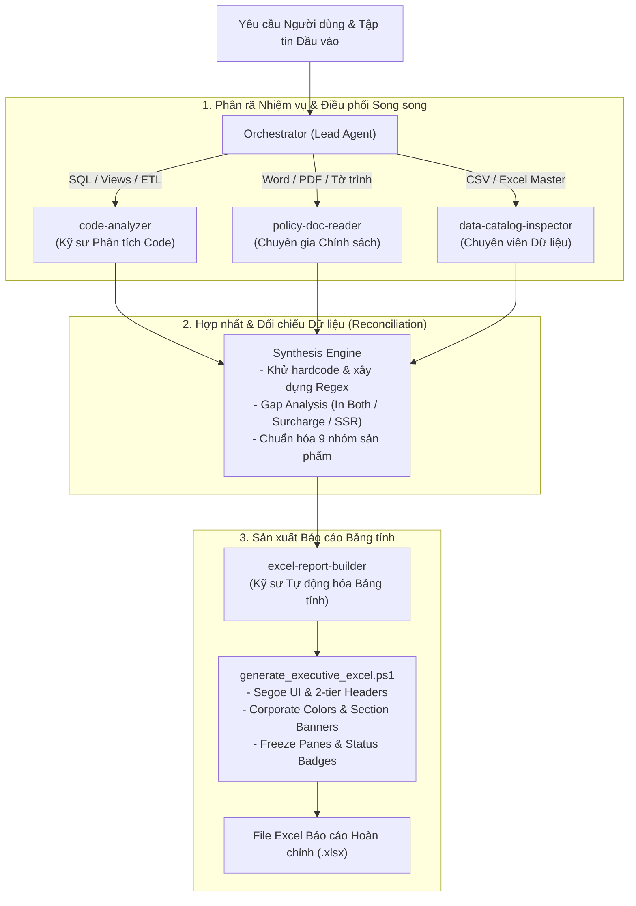

# Multi-Agent Requirement Analysis & Executive Excel Reporting Skill

Bộ skill chuẩn hóa kiến trúc **Multi-Agent Orchestration** giải quyết bài toán: Nhận diện yêu cầu nghiệp vụ phức tạp -> Quét và phân loại tập tin đầu vào đa định dạng -> Chia nhỏ nhiệm vụ cho các Subagents chuyên môn đọc song song -> Tổng hợp ma trận logic đối chiếu -> Tự động sinh file Excel báo cáo chuẩn Ban Tổng Giám đốc.

---

## 1. Kiến trúc Hệ thống Multi-Agent



---

## 2. Danh mục Subagents & Trách nhiệm Chuyên môn

| Subagent | Vai trò chính | Định dạng file phụ trách | Nhiệm vụ trọng tâm |
| :--- | :--- | :--- | :--- |
| `code-analyzer` | Kỹ sư Phân tích Code & ETL | `.sql`, `.txt`, `.py`, DDL | Bóc tách CTEs, joins, phân bổ nối chuyến (`factor`), phát hiện hardcoded IDs, đề xuất regex/master data join. |
| `policy-doc-reader` | Chuyên gia Nghiệp vụ & Chính sách | `.docx`, `.pdf`, `.txt` | Đọc Tờ trình, chính sách hoa hồng, đơn giá Counter vs Gate, loại hành lý (G, L, O), điều kiện loại trừ. |
| `data-catalog-inspector` | Chuyên viên Dữ liệu & Master Data | `.csv`, `.xlsx` | Thống kê cấu trúc, lọc bỏ mã nhiễu (thuế/phí sân bay: AI, SG, SF...), Gap Analysis giữa các hệ thống, quy hoạch 9 nhóm. |
| `excel-report-builder` | Kỹ sư Tự động hóa Bảng tính | `.xlsx`, `.json` | Nhận ma trận tổng hợp, chạy PowerShell `ImportExcel` / EPPlus để xuất workbook đa sheet đạt chuẩn Ban Lãnh đạo. |

---

## 3. Quy trình Vận hành 5 Bước (Standard Operating Procedure)

### Bước 1: Khảo sát Workspace & Lập Hồ sơ File
Chạy script quét và phân loại file trong thư mục làm việc:
```powershell
powershell -NoProfile -ExecutionPolicy Bypass -File ".agent/skills/multiagent-requirement-to-excel/scripts/inspect_workspace_files.ps1" -TargetFolder "." -OutputFile "file_inventory.json"
```

### Bước 2: Kích hoạt Subagents Phân tích Song song
Orchestrator sử dụng lệnh `invoke_subagent` để giao việc cụ thể cho từng chuyên viên:
1. **Giao cho `code-analyzer`**: Gửi đường dẫn các file SQL/DDL, yêu cầu bóc tách hardcoded IDs, CTEs, và logic nghiệp vụ.
2. **Giao cho `policy-doc-reader`**: Gửi file Word/Tờ trình, yêu cầu lập ma trận đơn giá và điều kiện chi hoa hồng.
3. **Giao cho `data-catalog-inspector`**: Gửi file CSV/Excel Master Data, yêu cầu phân loại nhóm, loại trừ thuế phí và đối chiếu chéo.

### Bước 3: Động cơ Tổng hợp & Hóa giải Xung đột (Synthesis Engine)
Orchestrator thu thập báo cáo từ các subagents và tiến hành:
- **Khớp nối Logic**: Đối chiếu các trường hợp trong SQL với các điều khoản trong Tờ trình để đảm bảo không bỏ sót trường hợp nào.
- **Loại trừ Nhiễu**: Lọc bỏ các mã không thuộc phạm vi Ancillary (ví dụ: Fares `FA`, Phí an ninh `SF`, Thuế sân bay `AI`, `SG`).
- **Quy hoạch Kiến trúc**: Thiết lập mô hình Medallion Databricks (Silver Models, Silver Analytics, Gold Marts).

### Bước 4: Tự động hóa Tạo File Excel Báo cáo
Chuyển ma trận dữ liệu đã tổng hợp cho `excel-report-builder` hoặc gọi script sinh bảng tính:
```powershell
powershell -NoProfile -ExecutionPolicy Bypass -File ".agent/skills/multiagent-requirement-to-excel/scripts/generate_executive_excel.ps1" -OutputPath "D:\Vietjet\2026\Tờ trình\Ancillary_Product_Groups_VN.xlsx"
```

### Bước 5: Thẩm định Chất lượng & Bàn giao
- Kiểm tra tính đầy đủ của 3 sheets: Bảng phân loại mới (12 cột), Bảng đối chiếu cũ (100 mã), và Quy hoạch Medallion (5 views).
- Kiểm tra trực quan: Font Segoe UI, Super-headers, Section banners, Freeze panes, đường viền mỏng và màu sắc trạng thái.

---

## 4. Tài nguyên Kèm theo Bộ Skill

- [Quy trình Điều phối Multi-Agent (Protocols)](./references/subagent_orchestration_protocols.md): Mẫu prompt và định dạng hợp đồng dữ liệu giữa các agents.
- [Quy chuẩn Thiết kế Bảng tính Doanh nghiệp (Design System)](./references/excel_design_system.md): Bảng màu, typography và tiêu chuẩn định dạng ô.
- [Case Study Thực tế Vietjet Ancillary](./examples/vietjet_ancillary_case_study.md): Bài học thực tiễn giải quyết bài toán di chuyển SQL sang Databricks và lập báo cáo.
- [Script Sinh Excel Chuyên nghiệp](./scripts/generate_executive_excel.ps1): Công cụ sinh file Excel đa tầng tự động.
- [Script Khảo sát File](./scripts/inspect_workspace_files.ps1): Công cụ quét và phân loại file đầu vào.
