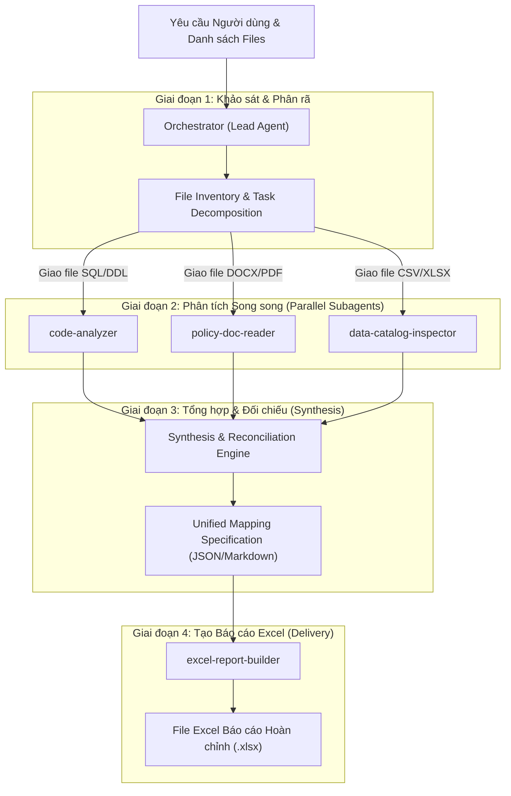

# Quy trình Điều phối Multi-Agent (Subagent Orchestration Protocols)

Tài liệu này định nghĩa chi tiết cơ chế hoạt động, định dạng trao đổi thông điệp (Contracts) và quy trình điều phối giữa **Orchestrator (Lead Agent)** và **4 Subagents chuyên trách**:
1. `code-analyzer`: Phân tích mã nguồn SQL, Procedures, DDLs, Views.
2. `policy-doc-reader`: Đọc hiểu tài liệu chính sách Word (.docx), Tờ trình, Biểu phí, Quy định hoa hồng.
3. `data-catalog-inspector`: Thẩm định danh mục dữ liệu Master Data, cấu trúc bảng CSV/Excel, phân tích độ phủ.
4. `excel-report-builder`: Tự động hóa lập bảng tính Excel tổng hợp đạt chuẩn Ban Tổng Giám đốc.

---

## 1. Kiến trúc Luồng Dữ liệu Tổng thể



---

## 2. Chi tiết Từng Giai đoạn & Mẫu Prompt Điều phối

### Giai đoạn 1: Khảo sát & Phân rã Yêu cầu (Intake & Decomposition)
Lead Agent nhận yêu cầu từ người dùng và quét danh mục file:
```powershell
powershell -NoProfile -ExecutionPolicy Bypass -File ".agent/skills/multiagent-requirement-to-excel/scripts/inspect_workspace_files.ps1" -TargetFolder "."
```
Sau đó, phân chia file cho đúng subagent dựa trên đuôi mở rộng và vai trò.

---

### Giai đoạn 2: Điều phối Subagents (Prompting Subagents)

#### 1. Gọi `code-analyzer`:
```text
Vai trò: Phân tích kỹ thuật mã nguồn SQL / Stored Procedure
Tập tin giao: [d:\Vietjet\Docs\PSS\gl_charges_detail.sql], [silver_dev.analytics.gl_booking_charges.txt]
Yêu cầu:
1. Liệt kê toàn bộ bảng nguồn, CTEs và điều kiện join.
2. Tìm và bóc tách toàn bộ danh sách hardcoded IDs (CASE WHEN id IN (...)).
3. Phân tích công thức tính toán: hệ số nối chuyến (factor), thuế sân bay, tỷ giá.
4. Đề xuất quy tắc Regex hoặc Master Data join để loại bỏ hardcoded IDs.
Trả về định dạng Markdown có cấu trúc rõ ràng.
```

#### 2. Gọi `policy-doc-reader`:
```text
Vai trò: Đọc hiểu tài liệu chính sách & Tờ trình kinh doanh
Tập tin giao: [KPI SAN BAY.docx], [[Anci reply FIN comment] TTr Chuong trinh hoa hong Anci.docx]
Yêu cầu:
1. Xác định thời gian áp dụng, phạm vi đường bay (Nội địa vs Quốc tế).
2. Trích xuất bảng đơn giá / mức chiết khấu / hoa hồng theo:
   - Vị trí thu: Tại quầy check-in sân bay (Counter) vs Cửa khởi hành (Gate).
   - Loại hành lý: Kiện tiêu chuẩn (G), Quá cước theo kg (L), Quá khổ (O).
3. Liệt kê các điều kiện loại trừ hoặc quy định làm tròn.
Trả về định dạng Bảng Ma trận Quyết định Chính sách (Policy Decision Matrix).
```

#### 3. Gọi `data-catalog-inspector`:
```text
Vai trò: Kiểm tra và đối chiếu danh mục Master Data (Quy chuẩn Peek-and-Script)
Tập tin giao: [surcharge.csv], [ssr.csv], [Ancillary Type.xlsx]
Yêu cầu bắt buộc:
1. TUYỆT ĐỐI CẤM đọc toàn bộ nội dung file vào context chat.
2. Dùng peek_data_sample.ps1 để khảo sát Header và 3 dòng mẫu để nắm cấu trúc cột.
3. Viết script PowerShell/Python để:
   - Thống kê số lượng bản ghi, lọc bỏ các mã không hợp lệ / thuế phí ngoài phạm vi (AI, SG, SF, FA...).
   - Thực hiện Gap Analysis (In Both Tables, Surcharge Only, SSR Only, Data Gap).
   - Gom nhóm và phân loại theo 9 nhóm quy chuẩn.
4. CHỈ gửi kết quả thống kê rút gọn (số lượng bản ghi mỗi nhóm, danh sách mã đại diện) về cho Orchestrator, KHÔNG in toàn bộ dữ liệu thô.
```

---

### Giai đoạn 3: Tổng hợp Logic & Xây dựng Ma trận Ánh xạ (Synthesis Engine)
Orchestrator nhận kết quả từ 3 subagents, tiến hành:
1. **Kiểm tra tính nhất quán (Consistency Check)**: Đảm bảo các mức hoa hồng trong SQL khớp với tài liệu Tờ trình (`Counter G 8k/12k`, `Counter L 3k/5k per kg`, `Gate G 5k/10k`, `Gate L 2k/4k per kg`, `Oversize 30k/60k`).
2. **Khử trùng lặp và loại trừ**: Lọc sạch các mã thuế/phí sân bay không thuộc phạm vi Ancillary.
3. **Chuẩn bị cấu hình sinh bảng tính**: Tạo cấu trúc JSON chứa đầy đủ metadata (Title, Subtitle, SuperHeaders, SubHeaders, Section Banners, Rows).

---

### Giai đoạn 4: Gọi `excel-report-builder` để Xuất File Excel
```text
Vai trò: Kỹ sư Tự động hóa Bảng tính Doanh nghiệp
Dữ liệu đầu vào: Cấu trúc ma trận ánh xạ tổng hợp từ Giai đoạn 3.
Đường dẫn xuất: D:\Vietjet\2026\Tờ trình\Ancillary_Product_Groups_VN.xlsx
Yêu cầu định dạng:
1. Font Segoe UI, Title 14pt Dark Blue (#1F4E78), Subtitle 10pt Italic.
2. 2-tier headers: Super-headers gộp nhóm màu nhận diện, Sub-headers 9.5pt pastel tương ứng.
3. Phân tách rõ ràng thành các Sections có Section Banner màu xám nhạt (#E6E6E6).
4. Định dạng màu sắc trạng thái (Status Badges):
   - Xanh lá (#375623) cho 'In Both Tables' / 'Đã chuyển đổi' / '100% Khớp'.
   - Xanh dương (#1F4E78) cho 'Surcharge Only' / 'SSR Only'.
   - Đỏ (#C00000) cho 'Data Gap' / 'Cần lưu ý'.
5. Bật đường lưới (ShowGridLines = $true), đóng băng khung nhìn (FreezePanes).
```

---

## 3. Quản lý Rủi ro & Xử lý Ngoại lệ
- **File bị khóa (File Lock)**: Trước khi ghi file Excel, script luôn thực hiện kiểm tra `FileStream` độc quyền. Nếu file đang mở trong Excel, đưa ra thông báo rõ ràng để đóng file.
- **Ký tự đặc biệt & Dấu tiếng Việt**: Sử dụng mã hóa UTF-8 chuẩn xác, truyền đường dẫn qua `-LiteralPath` hoặc sử dụng resolved string để tránh lỗi `ParserError` trên PowerShell Windows.
- **Thiếu hụt dữ liệu (Missing Data)**: Nếu subagent phát hiện mã giao dịch không có trong Master Data, đánh dấu nhãn "Data Gap" nổi bật để đội ngũ Kế toán / IT xử lý.
