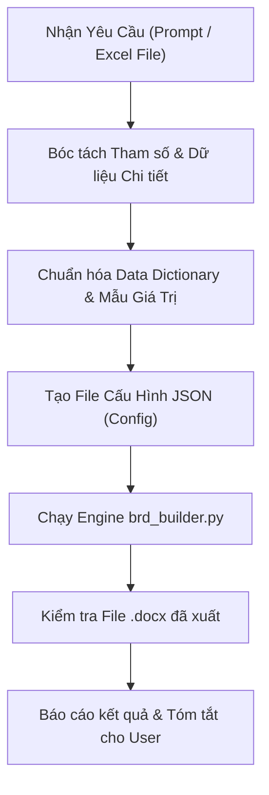

# Vietjet BRD Architect Skill (`vietjet-brd-architect`)

Kỹ năng chuyên biệt để tạo ra các tài liệu **Business Requirements Document (BRD)** chính thức cho Vietjet Aviation Joint Stock Company, tuân thủ tuyệt đối chuẩn nhận diện và thủ tục phê duyệt nội bộ.

---

## 🎯 1. Nhiệm Vụ Cốt Lõi
Khi nhận được yêu cầu soạn thảo BRD:
1. **Phân tích yêu cầu**:
   - Từ mô tả văn bản của người dùng HOẶC từ file Excel chỉ định (ví dụ `D:\Vietjet\2026\COM - Sale Reports\20260108_REPORT REQUEST TO IT.xlsx`).
   - Bóc tách:
     * Tên báo cáo (Tiếng Việt in hoa chuẩn & Tiếng Anh nếu cần).
     * Ngày tạo (mặc định ngày hiện tại định dạng `DD-MM-YYYY`, ví dụ `29-10-2026`).
     * Dự án / Phân hệ (mặc định: `Báo cáo quản trị thương mại` cho Khối Thương Mại, hoặc `Nghiệm thu báo cáo...` cho Khối Khai thác bay, Contact Center).
     * Người soạn thảo: `Cao Tiến Thành`.
     * Tham số đầu vào (Input Parameters / Bộ lọc).
     * Bảng dữ liệu chi tiết (Detailed Data Schema & Sample Values).
     * Mockup giao diện / KPI Cards / Ma trận báo cáo.
2. **Nguyên tắc Format Bất Di Bất Dịch**:
   - **GIỮ NGUYÊN 100%**: Logo Vietjet Air, trang bìa, khung kiểm soát thông tin (Table 0), địa chỉ trụ sở Vietjet, và toàn bộ các mục thủ tục A, B, C, D, E, F:
     * `A. Danh sách phân phối / List of distribution`
     * `B. Danh sách sửa đổi / Record of Revision`
     * `C. Danh mục trang có hiệu lực / List of effective pages`
     * `D. Căn cứ vào tài liệu / References`
     * `E. Kiểm tra và phê duyệt / Check and Approval`
     * `F. Xác nhận đơn vị tham gia rà soát / Check and Approval`
     * `Danh sách phân phối / List of distribution`
   - **MA TRẬN CỠ CHỮ & PHÔNG CHỮ CHUẨN THEO TỪNG PHẦN**:
     * Phông chữ: **100% Times New Roman** trên toàn văn bản.
     * **Tiêu đề trang bìa (Cover Title)**: `24.0 pt`, In đậm.
     * **Tiêu đề Mục lục (TOC Title)**: `16.0 pt`, In đậm.
     * **Heading 1 (Tiêu đề mục lớn A-F, I, II, III)**: `13.0 pt`, In đậm, Màu đỏ Vietjet `#EE0000`.
     * **Heading 2 (Tiêu đề mục con 1.1, 1.2, 2.1...)**: `13.0 pt`, In đậm, Màu đen `#000000`.
     * **Body text (Đoạn văn & Gạch đầu dòng)**: `12.0 pt`, Thường (`Regular`).
     * **Tiêu đề cột bảng (Table Header)**: `12.0 pt`, In đậm, Nền xám `#D7D7D7`.
     * **Dữ liệu ô bảng (Table Data Cell)**: `12.0 pt`, Thường (`Regular`).
     * **Running Header Section 1**: `9.0 pt`.
   - **CHỈ THAY ĐỔI**: Tên báo cáo, ngày tạo báo cáo, và nội dung các Mục I, II, III.
3. **Sinh File `.docx` Tự Động**:
   - Sử dụng script engine `D:\Thành\Agent\projects\vietjet-brd\scripts\brd_builder.py` để sinh file Word chuẩn, không bị lệch lề, không mất bảng, đúng màu đỏ Vietjet `#EE0000`, xám `#D7D7D7` và font Times New Roman.

---

## 🛠️ 2. Quy Trình Thực Hiện Từng Bước (Execution Workflow)



### Bước 1: Trích xuất thông tin
- Nếu có file Excel: chạy `excel_reader.py` hoặc đọc trực tiếp bằng Python để lấy dòng yêu cầu, tên các cột, bộ lọc.
- Nếu người gửi mô tả: tổng hợp lại thành danh sách bảng tham số và bảng trường dữ liệu chi tiết (gồm STT, Tên cột, Định nghĩa, Ví dụ thực tế, Ghi chú/Công thức).

### Bước 2: Chuẩn bị cấu hình JSON
Tạo file config JSON tạm (hoặc truyền đối tượng Python) chứa:
```json
{
  "report_title": "BÁO CÁO CÁC DỊCH VỤ BÁN THÊM CỦA ĐỐI TÁC",
  "title_line1": "BÁO CÁO CÁC DỊCH VỤ BÁN THÊM CỦA ĐỐI TÁC",
  "title_line2": "THEO ĐƯỜNG BAY VÀ ĐẠI LÝ",
  "create_date": "29-10-2026",
  "project_name": "Báo cáo quản trị thương mại",
  "issued_by": "Cao Tiến Thành",
  "version": "1.0",
  "overview_text": "...",
  "definitions": [
    ["1", "Thuật ngữ A", "Định nghĩa chi tiết..."]
  ],
  "input_parameters": [
    ["1", "Flight Date From", "Chọn ngày bay bắt đầu", "01/01/2026", "Bắt buộc"]
  ],
  "detailed_fields": [
    ["1", "Flight_Date", "Ngày bay thực tế", "15/01/2026", ""]
  ],
  "dashboard_kpis": [
    "Total Revenue: ...",
    "Total Volume: ..."
  ]
}
```

### Bước 3: Chạy Engine sinh file docx
```bash
uv run --with python-docx python "D:\Thành\Agent\projects\vietjet-brd\scripts\brd_builder.py" --config "path/to/config.json" --output "D:\Vietjet\2026\COM - Sale Reports\BRD\<ten_file_brd>.docx"
```

### Bước 4: Kiểm tra và hoàn tất
- Xác nhận file docx đã tạo thành công tại đúng thư mục đích.
- Cung cấp clickable link và tóm tắt ngắn gọn các trường dữ liệu cho người dùng.

### Bước 5: Cập nhật Checkpoint & Bàn giao
- Cập nhật tiến độ vào `knowledge/checkpoint.md`.
- Kích hoạt `gitops-gatekeeper` nếu có thay đổi mã nguồn/script cần commit vào kho lưu trữ.
